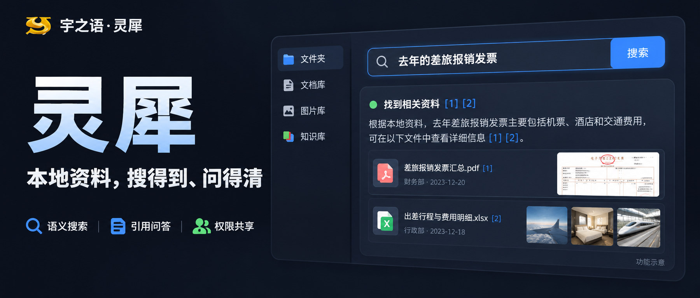
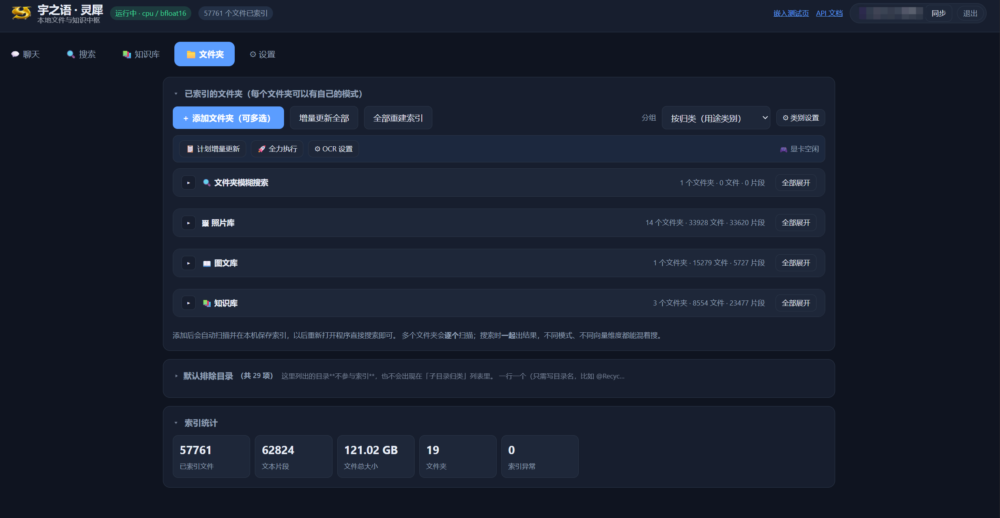
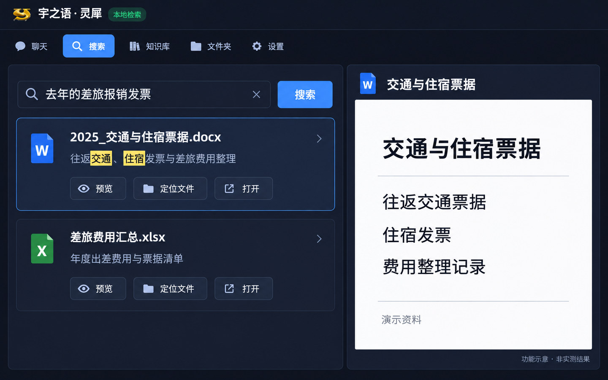

# 宇之语 · 灵犀　本地资料，搜得到、问得清

> 当前版本 **v3.5.11**（2026-11-03）｜Windows 本机版 / Linux 服务器版｜
> 安装部署见 [docs/安装部署手册-v3.5.md](docs/安装部署手册-v3.5.md)

你有没有遇到过这种情况：

明明记得那份资料讲过什么，却忘了文件叫什么；存了几年的照片，想找某个人、某次活动，只能一张张翻；制度文档找到了，还得再读一遍，才能回答同事的问题。

文件一直都在，难的是把它重新找出来、用起来。

**宇之语·灵犀，就是我为这些场景做的一套本地文件与知识中枢。**

把常用目录加入索引后，你可以用一句话找资料，也可以围绕资料提问、查看引用来源。文档、图片、录音按需要选择处理方式，个人电脑能用，自己的服务器也能部署。

先看一张我目前使用的界面。

*上图为实机截图：当时已索引 57,761 个文件、62,824 个片段，涉及 121.02 GB 文件、19 个文件夹。这是该资料库的一次状态快照，不是速度测试，也不代表索引数据库本身有 121.02 GB。*

## 01 不记文件名，也能按内容找

传统搜索更擅长“文件叫什么”，但我们往往只记得“里面说了什么”。

在灵犀里，可以试着这样问：

- 去年的差旅报销发票。
- 讲极光成因的资料。
- 蓝色圆形的产品配图。
- 计算个人所得税的代码。

**它把语义检索和文件名等匹配方式结合起来，尽量从内容里找线索，而不是只等你猜对关键词。**

找到之后，不用再来回切换窗口：图片、PDF 和音视频可以预览；支持提取正文的文本、Office 文件可以查看内容；还可以定位原文件、用默认程序打开，或下载一份使用。预览中的关键词高亮，也方便继续核对。

*功能示意图，文件与结果为演示内容；实际结果取决于资料内容、索引模式和模型。*

搜图有个前提：对应目录需要开启图片相关模式，并完成索引。不是把图片放进文件夹，就已经“读懂”了整座素材库。

## 02 找到资料之后，还能继续问

搜索回答“文件在哪”，知识库问答则帮你进一步整理“文件怎么说”。

比如，把公司的差旅制度和报销流程设为知识库后，可以问：

> 出差住宿费怎么报销？需要准备哪些材料？

灵犀会检索被标记为“知识库”的文件夹，结合相关段落组织回答，并展示引用来源。想确认某句话，可以回到原文继续看，而不是只拿到一段没有出处的总结。

它支持连续追问；接入支持视觉输入的模型后，也可以传图提问。已有 Dify 知识库的用户，还可以按配置一起检索，本地资料和 Dify 来源会分别标记。

*图中问题、回答和制度文件均为演示内容，不是实际报销规定。*

**带引用，方便核对，但不等于回答一定正确。** 涉及金额、日期、合同条款等重要信息，仍然要看原文。资料不足时，也不应把模型补充的内容当成你的文件结论。

这里还要区分两个模型：负责检索的嵌入模型，和负责组织回答的生成模型。能在本地搜索，并不等于已经装好了本地问答模型。

## 03 文档、照片、录音，不必用同一种方式建库

有些目录是工作文档，有些是照片，还有些只是安装包。全部按最高配置处理，既费时间，也没必要。

灵犀允许每个文件夹单独设置索引方式：

- **文档、代码：** 优先用仅文字模式。
- **产品图、截图：** 按需要开启文字与图片处理。
- **会议录音：** 开启音频相关模式，完成相应索引后再检索。
- **安装包、归档备份：** 可以只索引文件名，不读取正文。

索引建好后，平时直接查已有索引；目录更新后，再做增量更新。首次建库需要时间，多少文件、文件类型、模型配置和硬件都会影响耗时。换取的是后续使用时，不必每次重新遍历、重新理解全部文件。

### 照片不只靠文件名

除了图像语义检索，还可以按需开启图片描述和人物功能。

图片描述可以给照片补充文字线索；人物功能则把相似人脸归到一起，**由你确认、命名、合并或纠正**，再用来按人物筛选照片。聚类结果可能把同一个人拆成几组，也可能认错，不能直接当作身份鉴定。

*功能示意图，人物为 AI 生成的虚构形象，姓名及照片内容均为演示。人物功能可选，不开启也不影响基础文件搜索。*

### 扫描件，按需要补 OCR

**能提取文字的 PDF，不装 OCR 也可以读取正文。** 扫描 PDF、纯图片中的文字，则需要 OCR 才能补进文字索引。

当前项目可按配置接入 RapidOCR、PP-OCRv6、MinerU、OXR 等工具。日常扫描件可以先从轻量方案试起；有复杂版面、表格、图片提取需求，再考虑更重的方案。具体速度、效果和显存需求，以所选引擎与运行配置为准。

同一张中文报销单的实测（本机 RTX 3060 Ti）：**MinerU 3.8 秒 / OXR 33 秒**，两家都能把表格还原成 HTML。OXR 会把空格和全角标点保留得更准（`金额（元）`、`高铁 北京→上海`），MinerU 更快、合并单元格带 `rowspan/colspan`。日常大批量建库用 MinerU，报表、合同这类少量但要"像原文"的用 OXR。两家默认都占 8000 端口，同时用需要给其中一个换端口（本机 MinerU 走 8100）。

## 04 “本地”要说清楚：哪些留在本机，哪些会访问外部服务

这是我最想讲明白的一点。

**本地索引和本地检索，可以在必要模型准备好后离线运行。** 如果问答、图片处理也全部使用本机模型，就可以把相应处理留在自己机器上。

但灵犀也提供外部 API、联网搜索、Dify 等可选连接。启用这些能力，就会访问配置的服务；例如使用外部问答模型时，允许参与回答的检索片段会随请求发送过去。

所以，“支持本地部署”不能简单等同于“无论怎么配置，都不会发出任何资料”。

对敏感目录，项目提供了“隐私文件夹”设置：**当前知识库问答流程会过滤这类目录的片段，不把它们交给外部回答模型；图片打标也会强制选择本地处理。** 需要这些资料参与问答时，应使用本机模型。

文件权限、网络访问和备份也要一起管理。这个开关有明确用途，但不能代替全部安全措施。

## 05 多人共用时，资料和模型都能划分范围

如果一个人用，重点是找资料；几个人一起用，还要分清“谁能看到什么”。

灵犀可以部署在自己的服务器上，通过账号、文件夹归属和共享设置，区分个人资料与共同资料。普通用户按配置查看自己名下和共享给自己的内容，而不是默认翻遍所有人的目录。

模型和 Dify 连接也可以设置使用范围：只给自己、给所有登录用户，或指定用户。服务端使用的 API 密钥，不作为普通前端配置直接分发给其他账号。

当前的服务器使用流程，是在建库机完成索引，再按权限上传同步。多人共用前，建议先用两个普通账号验证资料与模型的可见范围，再迁入正式资料。

备份也没有落下：项目提供快照、数据库备份、恢复及定时备份相关工具。迁移、升级或重建前，先留一份可用备份，比事后补救省事。

服务器上的日常运维也做进了界面：网络盘（NAS）重启后目录失效，管理员点「🔄 重新检查目录」立刻重查，不行再点「♻ 重启服务」——不用登录服务器敲命令。这个按钮只有管理员看得到、也只有管理员能调。

## 06 五个标签，用的时候不用到处找

现在的主界面就是五个入口：

- **聊天：** 多会话对话，按需要接入联网搜索、本地知识库、Dify、附件和导出。
- **搜索：** 用自然语言找文件，预览并回到原文件。
- **知识库：** 围绕指定资料提问，查看引用和追问。
- **文件夹：** 添加目录、设置模式、增量更新、排除无用目录、查看索引状态；目录掉线了还能一键重新检查。
- **设置：** 管理服务器与共享、模型、人物命名、备份与恢复。

常用的事情放在前面，耗资源的处理按需打开。不必为了搜几份文档，把所有可选功能都装一遍。

## 谁适合用，谁可以先不用

如果你有大量本地文档、照片、设计素材，或者想让自己的资料参与问答，灵犀值得拿一个小目录试试。需要个人与小团队共用、又希望掌握模型和数据去向的场景，也可以进一步了解。

但如果只是精确查文件名，Everything 这类工具往往更直接；资料都在某个网盘里，网盘现有搜索也可能够用。

硬件方面，**当前 v3.5 安装手册建议 Windows 10/11 64 位，至少 8 GB 内存、20 GB 可用空间，推荐 16 GB 以上内存。** 没有独显可以走 CPU，但建库与模型推理通常更慢；可选的视觉、音频、OCR 和问答模型，还会增加资源需求。大资料库也需要为索引和备份预留空间。

## 从一个常用目录开始

首次使用，不建议直接把整个硬盘都丢进去。

1. 按《安装部署手册 v3.5》准备本机版或服务器版；老用户先阅读升级手册。
2. 解压到固定目录，按说明运行 `setup.bat` 准备依赖与必要模型；之后**双击 `启动灵犀.vbs`**（或桌面快捷方式「灵犀」）启动——v3.5.4 起服务在后台跑，**不再弹命令行黑框**，也不会被误关；要停服务双击 `stop.bat`。
3. 首次启动后创建管理员账号，确认本地模型和设备配置。
4. 添加一个熟悉的小目录，选择模式，完成索引。
5. 用几个自己知道答案的问题试搜，再根据效果逐步扩大资料范围。

初次安装通常需要联网下载依赖和模型，实际耗时取决于网络、硬件与可选组件。**“能离线使用”，说的是准备完成后的相应本地功能，不是首次安装也完全不用网络。**

资料越多，越容易变成“存的时候很认真，用的时候找不到”。我想让灵犀做的，是少一点这种来回翻找：先找到相关文件，再带着出处，把问题弄清楚。

**关注公众号「宇之语」。** 想了解灵犀的安装部署、升级和具体使用场景，欢迎留言交流；也欢迎把文章转给那个经常说“我明明存过”的朋友。

---

## 技术文档（想动手装、想改代码看这里）

| 文档 | 内容 |
|---|---|
| [安装部署手册 v3.5](docs/安装部署手册-v3.5.md) | 本机版 / 服务器版、网络盘与重启、OCR 组件 |
| [升级部署手册 v3.5](docs/升级部署手册-v3.5.md) | 老版本升上来、数据库与配置怎么保留 |
| [技术说明](docs/技术说明.md) | 接口与配置项细节（原 README，含 API、参数表、性能记录） |
| [更新日志](docs/更新日志.md) | 每个版本改了什么、修了哪些问题 |
| [GitHub 发布与更新](docs/GitHub-发布与更新.md) | 仓库里有什么、怎么拉取更新 |

> 仓库里**只有代码**：索引库、模型权重、`config.ini`（含密钥）、备份都不会提交。
