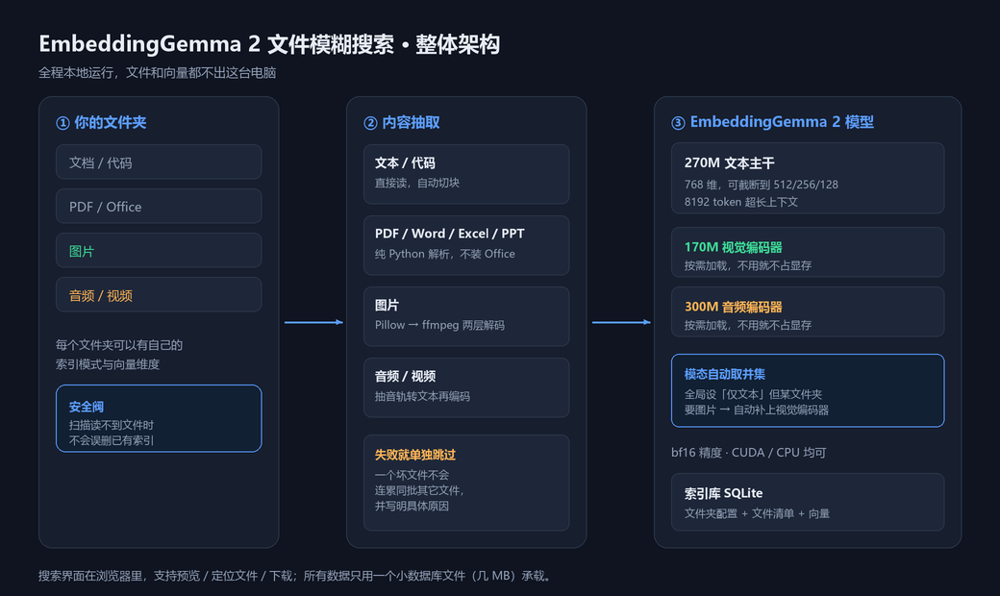
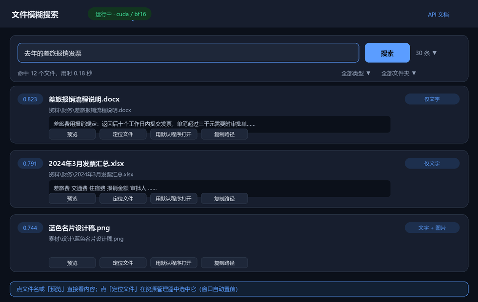
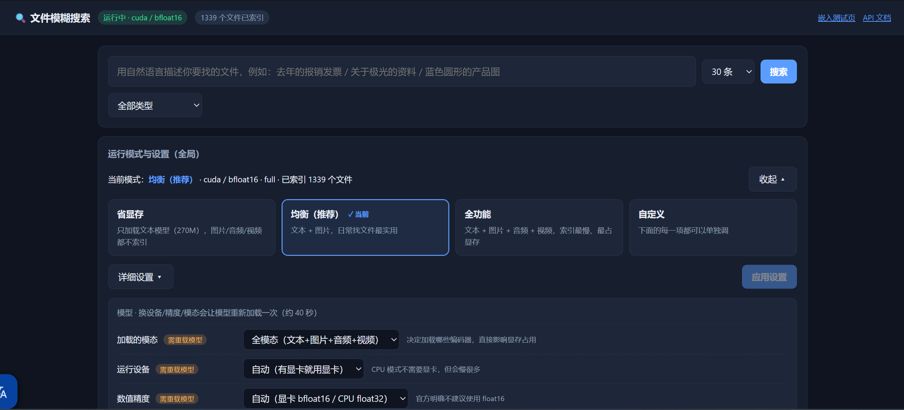
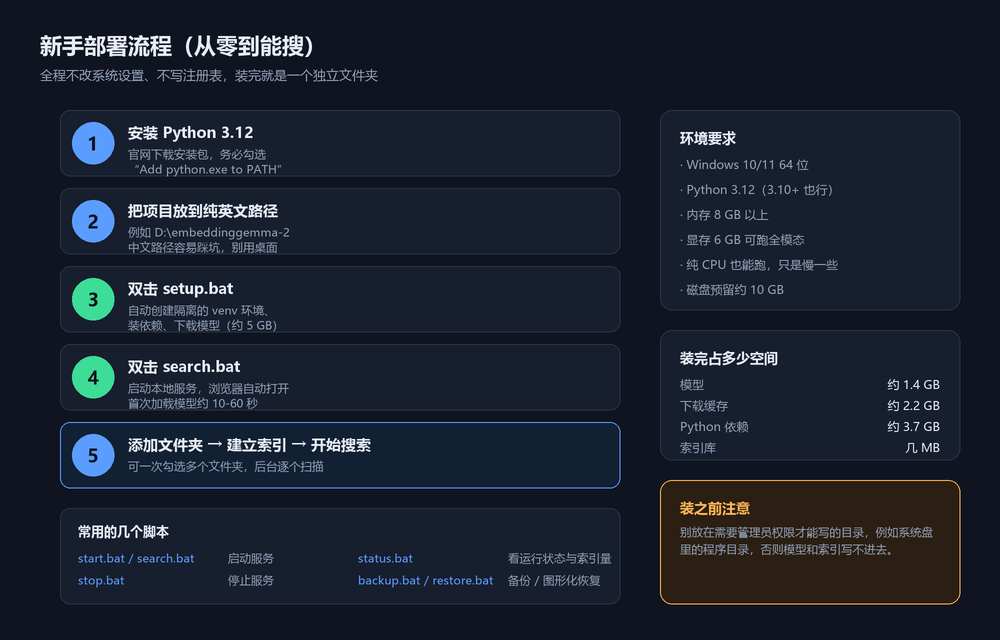
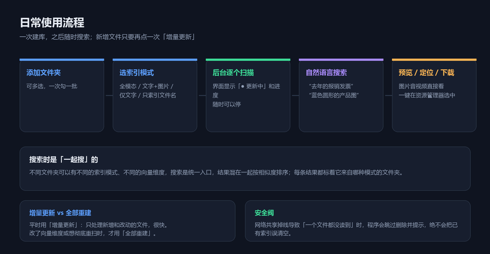

# 再也不怕找不到文件：给自己的电脑装一个「听得懂人话」的本地搜索

> ⚠ **已作废（2026-10-22）**：这是 v2 时期"本地搜索"角度的旧稿，不再对外使用。
> 现在用 `docs/公众号推广文-灵犀.md`（讲灵犀整体的新版）。

> 用大白话搜文件，全程离线，不传云端。
> 一个文件夹、一个 Python，30 分钟装好。

---

## 先说一个每天都在发生的场景

你要找一份文件。

你记得它大概是**去年**做的，内容跟**差旅报销**有关，可能是 Word 也可能是 PDF。
然后你打开资源管理器，开始一场漫长的考古：

- 翻文件夹，一层套一层，翻到第五层忘了自己在找什么；
- 用系统搜索搜"报销"，结果出来八百个，因为文件名里都带着"报销"俩字；
- 换关键词试了七八次，最后靠**按修改日期排序肉眼扫**；
- 或者干脆放弃了，重新做一份。

**这不是你的记性问题，是搜索方式的问题。**

传统的文件名搜索只能匹配字符。可你脑子里记的是**意思**，不是文件名。
这两件事之间，一直缺一层翻译。

---

## 现在补上这一层

把这个项目装到电脑上之后，搜索方式变成这样：

| 你想找的东西 | 你直接打 |
| --- | --- |
| 去年那份差旅报销的发票 | `去年的差旅报销发票` |
| 讲极光成因的那份资料 | `极光是怎么形成的` |
| 蓝色圆形的产品配图 | `蓝色圆形的产品图` |
| 那个算税的 Python 脚本 | `计算个人所得税的代码` |
| 会议里提到预算的那段录音 | `会议里讨论预算的部分` |

不用记文件名，不用猜扩展名，不用回忆放在哪个盘。**把意思说出来就行。**

而且 —— **它认得图片**。你说"蓝色圆形"，它能把符合描述的图找出来；
你说"一张表格截图"，它也能找。这是普通文件名搜索永远做不到的事。



---

## 它凭什么能做到

因为它不是"匹配字符"，而是**理解语义**。

背后是 Google 的 `embeddinggemma-2` 模型（740M 参数），
它把一段文字、一张图片、一段音频都变成同一套"语义坐标"里的点：

```
"差旅报销发票"  →  [0.12, -0.83, 0.44, ...]    ┐
                                                ├─ 距离很近 → 匹配
"出差费用票据"  →  [0.11, -0.81, 0.46, ...]    ┘
"蓝色圆形图标"  →  [-0.55, 0.20, 0.91, ...]    ── 距离很远 → 不匹配
```

搜的时候，把你的话也变成同样的坐标，去库里找最近的。
**顺序、用词、语序都不重要，意思对就行。**

---

## 五个真正的亮点

### 1. 全程离线，隐私零风险

文件和向量都留在这台电脑上，不传云端、不需要账号、断网也能搜。
模型跑在你自己的显卡上（没有独显也能用 CPU 跑）。

对于**合同、财务报表、客户资料**这类不能上传的东西，这一点是刚需。

### 2. 一个文件夹就是一个完整程序

不改系统设置、不写注册表、不装系统服务、不动 PATH。
所有东西——程序、模型、缓存、索引、日志——**全部在项目文件夹里**。

不想要了？`stop.bat` 然后删文件夹，干干净净，不留垃圾。

### 3. 每个文件夹可以有自己的策略

这是很实用的一点：

| 文件夹 | 怎么配 | 为什么 |
| --- | --- | --- |
| 文档 / 代码资料 | 仅文字 | 最快，用不上图片 |
| 产品图 / 截图素材 | 文字 + 图片 | 可以用"蓝色圆形"找图 |
| 录音 / 会议记录 | 文字 + 音频 | 能按声音内容找 |
| 安装包 / 备份 | 只索引文件名 | 不读内容，秒级完成 |

而且**搜索是统一入口**——不同模式、不同向量维度的结果混在一起按相关度排序，
每条结果还标着它来自哪种模式的文件夹。


### 4. 找完还能直接用

不只是给你一个路径。搜到之后：

- **预览** —— 图片、PDF、音视频直接看；文本和 Office 显示正文并**高亮你搜的词**
- **定位文件** —— 打开资源管理器并选中它，窗口自动置前
- **用默认程序打开** —— 交给 Word / 看图 / 播放器
- **下载到本机** —— 存一份出来





### 5. 界面里能调，不用改配置文件

三个一键预设（省显存 / 均衡 / 全功能）随时切，改设备、改精度、改维度都不用重启程序。
另外还有 15 项细调，每项都标了"立即生效"还是"需要重载模型"。

---

## 怎么拿到

项目以**压缩包**分发，约 **1 MB**（不含模型，模型由安装脚本自动下载）。

> **下载地址：`<请替换为你的分享地址>`**

拿到后解压到纯英文路径，双击 `setup.bat` 即可。也可以自己重新打包分发：

```bat
venv\Scripts\python.exe docs\make_package.py
```

## 装起来要多久

**大概 30 分钟**，其中 25 分钟是挂着下载。



```bat
:: 1. 装 Python 3.12（勾选 Add python.exe to PATH）

:: 2. 把项目解压到纯英文路径，例如 D:\embeddinggemma-2

:: 3. 双击 setup.bat     ← 自动建环境、装依赖、下模型（约 5 GB）

:: 4. 双击 search.bat    ← 浏览器自动打开
```

就这四步，中间不用敲任何命令。

第 4 步之后，点「＋ 添加文件夹（可多选）」，
勾上你平时总找不到东西的那几个目录，选个模式，剩下的它自己扫。



---

## 适合谁用

**特别适合：**

- 电脑里存了几万份文件，靠记忆和肉眼在找
- 有大量**素材**（图片、截图、设计稿），想按画面内容找
- 有**不能上传云端**的敏感资料，但想要智能搜索
- 需要跨格式检索 —— 同一个问题，答案可能在一份 PDF、一张图、一段录音里

**可能不需要：**

- 只想做纯文件名匹配 → 用 [Everything](https://www.voidtools.com/) 更快更轻
- 文件都存在网盘里、本地几乎没东西 → 网盘自带的搜索可能够用
- 机器只有 4 GB 内存又没有独显 → 能跑，但会比较慢

---

## 和常见方案比一比

| 方案 | 语义搜索 | 搜图片内容 | 数据出本机 | 跨格式 |
| --- | --- | --- | --- | --- |
| Windows 自带搜索 | ✗ 只匹配文件名 | ✗ | ✓ | ✗ |
| Everything | ✗ 只匹配文件名 | ✗ | ✓ | ✗ |
| 网盘智能搜索 | ✓ | 部分 | **✗ 要上传** | 部分 |
| 云端 AI 助手 | ✓ | ✓ | **✗ 要上传** | ✓ |
| **本项目** | **✓** | **✓** | **✓ 全本地** | **✓** |

---

## 几个实实在在的细节

这些都是实际用起来才会在意的地方，项目里都处理了：

- **断点续传**：模型下载中断了，重新双击 `setup.bat` 接着下，不用从头来。
- **数据安全阀**：网络共享或移动硬盘扫到一半掉线，程序**不会**误以为"文件都删了"
  而清空索引 —— 它会跳过删除并提示你。
- **坏文件不连累别人**：一张图解码失败，只有它自己被跳过并写明原因，
  同批其它文件照常入库。
- **一键自检**：`selftest.bat` 会把模型、接口、索引、页面全部检查一遍。
- **图形化备份恢复**：`backup.bat` 一键备份（服务开着也能备份），
  `restore.bat` 弹文件框点一下就能恢复，还会自动留一份安全副本。

---

## 开始之前，请确认

- [ ] Windows 10/11 64 位
- [ ] Python 3.10+（推荐 3.12），**安装时勾了 `Add python.exe to PATH`**
- [ ] 磁盘留出 10 GB
- [ ] 项目放在**纯英文路径**、且**不需要管理员权限**的目录

装完之后，第一件事建议是：**把那几个"每次找东西都要翻半天"的目录加进去**。
先建一个，感受一下用大白话把文件搜出来的感觉。

之后你会发现，回忆文件叫什么名字这件事，慢慢就不需要了。

---

## 附：完整文档

- **新手部署使用笔记**（含手动逐步命令、备份恢复、故障排查）→ `docs/新手部署使用笔记.md`
- **项目详细文档**（接口、设置项、性能数据）→ `README.md`
