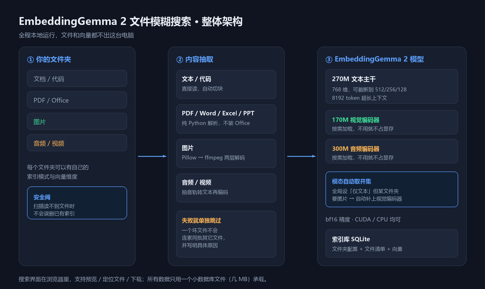
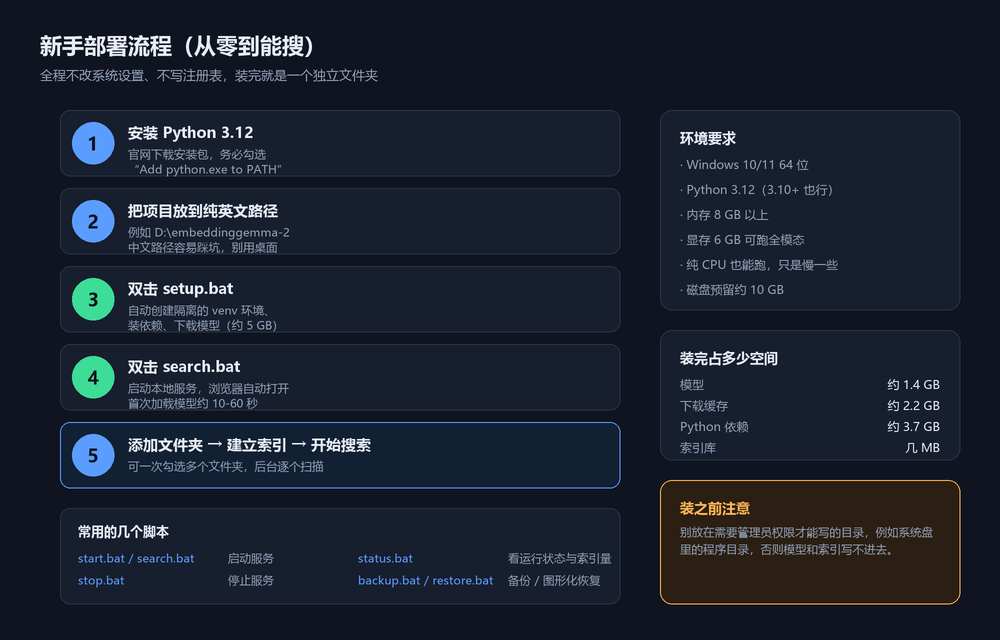
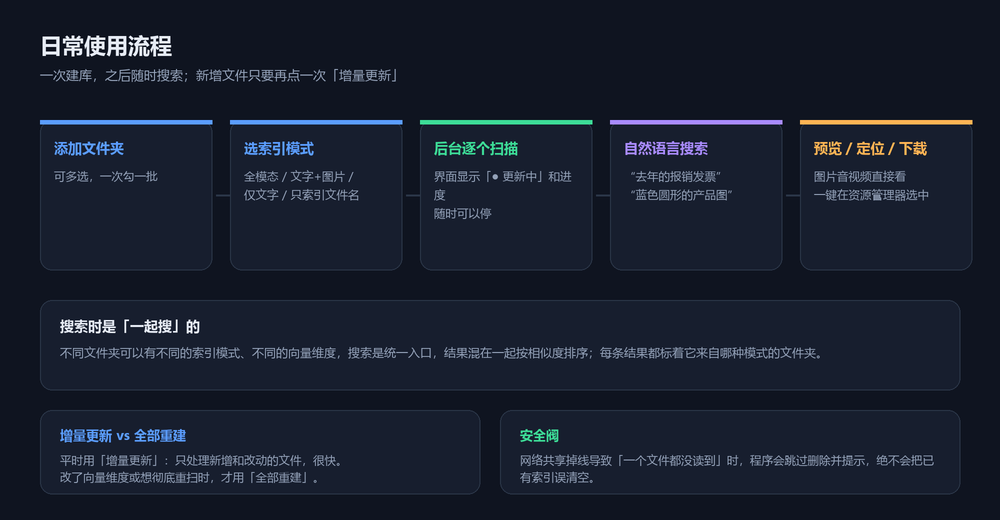
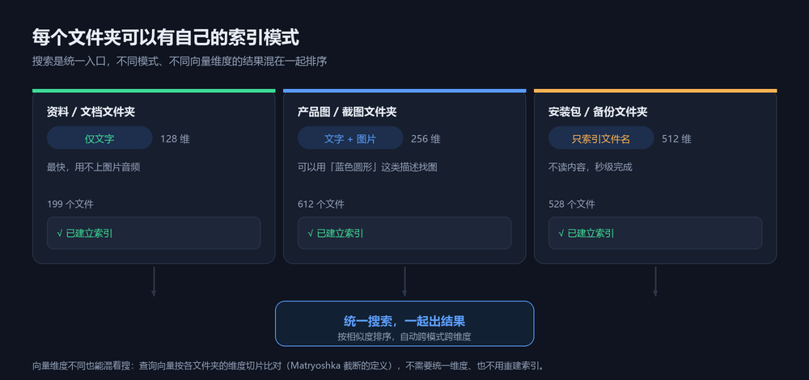

# 宇之语 · 灵犀 · 新手部署使用笔记

> 一份从零开始的完整笔记。全部操作都在一个文件夹里，**不改系统设置、不写注册表、不装服务**，
> 不想要了直接删文件夹即可。

---

## 目录

- [零、先拿到项目文件](#零先拿到项目文件)
- [一、这个项目能做什么](#一这个项目能做什么)
- [二、它是怎么工作的](#二它是怎么工作的)
- [三、部署前的准备](#三部署前的准备)
- [四、部署（推荐：一键脚本）](#四部署推荐一键脚本)
- [五、部署（手动，逐步命令）](#五部署手动逐步命令)
- [六、启动与关闭](#六启动与关闭)
- [七、建立索引并开始搜索](#七建立索引并开始搜索)
- [八、每个文件夹用不同模式](#八每个文件夹用不同模式)
- [九、界面上能调什么](#九界面上能调什么)
- [十、备份与恢复](#十备份与恢复)
- [十一、出问题怎么查](#十一出问题怎么查)
- [十二、文件清单](#十二文件清单)
- [十三、怎么卸载](#十三怎么卸载)

---

## 零、先拿到项目文件

### 1. 下载项目包

本项目以**压缩包**形式分发，只有约 **1 MB** —— 模型和依赖不在包里，
由 `setup.bat` 第一次运行时自动下载。

| 要下载的东西 | 地址 |
| --- | --- |
| **① 本项目压缩包** | **`<请替换为你的分享地址>`** |
| ② Python 3.12 | https://www.python.org/downloads/windows/ |
| ③ PyTorch（按显卡选命令） | https://pytorch.org/get-started/locally/ |
| ④ 底层嵌入模型（官方） | https://huggingface.co/google/embeddinggemma-2 |
| ⑤ 模型国内镜像（备用） | https://www.modelscope.cn/models/google/embeddinggemma-2 |

> **① 的地址由分享者提供**（GitHub Release / 网盘 / 内网共享都行）。
> 拿到压缩包后**解压到纯英文路径**（例如 `D:\embeddinggemma-2`），里面就是完整项目，
> 双击 `setup.bat` 开始。②③④ 一般不用手动下，`setup.bat` 会自己处理，
> 列在这里是为了万一自动下载失败时你能手动补上。

### 2. 包里有什么、没有什么

**包含**（约 1 MB，52 个文件）：

```
先读我-从这里开始.txt      三步上手说明
setup.bat / search.bat / stop.bat / restart.bat / status.bat
backup.bat / restore.bat / fix-permissions.bat / selftest.bat / start.bat
config.ini                 配置文件
requirements.txt           依赖清单
README.md                  完整功能与接口文档
app\                       程序源码（20 多个 .py + 网页界面）
docs\                      本笔记 + 推广文 + 6 张配图
```

**不包含**（`setup.bat` 会自动生成，合计约 7 GB）：

| 目录 | 大小 | 说明 |
| --- | --- | --- |
| `venv\` | 约 3.7 GB | Python 运行环境，按你的系统现场创建 |
| `models\` | 约 1.4 GB | 模型本体，下载得到 |
| `.cache\` | 约 2.2 GB | 下载缓存，下载产生 |

这样做的好处：压缩包小到能直接发微信/邮件，也不用担心模型版本对不上。

### 3. 想自己重新打包分发

拿到完整项目后，在项目里执行：

```bat
venv\Scripts\python.exe docs\make_package.py
```

会在 `dist\` 下生成 `embeddinggemma2-search-v<版本>.zip`，
自动排除 `venv` / `models` / `.cache` / `data` / `logs` / 缓存文件。

---

## 一、这个项目能做什么

一句话：**用大白话搜自己电脑里的文件**。

你不用记得文件名。想找"去年那份差旅报销的发票"，直接这么打进去就行；
想找"蓝色圆形的产品图"，打文字描述，图片也能被搜出来。

| 能搜的 | 说明 |
| --- | --- |
| 文档正文 | `txt / md / py / js / …` 代码和纯文本，按段落切块后建索引 |
| PDF | 抽取文字层（扫描件不行，那是图片，见下一条） |
| Word / Excel / PPT | 直接解析文件结构，**不用装 Office** |
| 图片 | 用文字描述画面内容来找图 |
| 音频 / 视频 | 抽音轨转文字后参与检索 |
| 文件名 | 所有文件都有，连"只索引文件名"的文件夹也能搜到 |

搜到之后可以直接：**预览内容**、**在资源管理器里定位**、**用默认程序打开**、**下载到本机**。



---

## 二、它是怎么工作的

三步：

1. **扫描**你指定的文件夹，把每个文件的内容抽出来（文字、图片、音频）；
2. 用模型把内容转成**向量**（一串数字，语义越接近数字越像），存进一个 **SQLite 数据库**；
3. 搜索时把你输入的话也转成向量，在库里找最接近的，返回文件列表。

关键点：

- **全部在本机完成**。文件和向量都不出这台电脑，断网也能用（除了第一次下模型）。
- 模型是 `google/embeddinggemma-2`，**740M 参数**：270M 文本主干 + 170M 视觉编码器 + 300M 音频编码器。
- 后面两个**按需加载**：你只搜文档，就不占那部分显存。
- 索引用 **Matryoshka 表示**，向量可以截断成 128 / 256 / 512 / 768 维。维度越低越快越省，
  256 维基本看不出差别，**不同文件夹可以用不同维度、还能一起搜**。

---

## 三、部署前的准备

| 项目 | 要求 | 说明 |
| --- | --- | --- |
| 系统 | Windows 10 / 11 64 位 | 脚本是 `.bat`，其它系统需自己改命令 |
| Python | **3.12**（3.10 以上都行） | 安装时**务必勾选 `Add python.exe to PATH`** |
| 内存 | 8 GB 以上 | 模型本身约 2 GB |
| 显卡 | 6 GB 显存可跑全模态 | 没有独显也能跑，纯 CPU 慢一些 |
| 磁盘 | 约 10 GB | 模型 1.4 G + 缓存 2.2 G + 依赖 3.7 G |
| 网络 | 首次需要 | 下载依赖和模型，之后完全离线 |

**两个容易踩的坑，先看这里：**

1. **路径别放中文**。解压到 `D:\embeddinggemma-2` 这种纯英文路径最稳，
   中文路径在某些 Python 库上会出问题。
2. **别放在需要管理员权限才能写的目录**（例如 `C:\Program Files`），
   否则模型、缓存、索引都写不进去。放在用户目录或数据盘都行。

---

## 四、部署（推荐：一键脚本）



### 1. 装 Python

去 python.org 下载 3.12 的 Windows 安装包，双击安装。

> **安装第一屏一定要勾上 `Add python.exe to PATH`**，不勾后面脚本会找不到 Python。

验证：按 `Win + R` 输入 `cmd` 回车，敲：

```bat
python --version
```

能看到 `Python 3.12.x` 就对了。

### 2. 把项目放到纯英文路径

解压/复制到例如 `D:\embeddinggemma-2`。

### 3. 双击 `setup.bat`

它会自动完成：

- 在项目里建一个**独立的 Python 虚拟环境** `venv\`（不污染系统 Python）
- 安装依赖（PyTorch、transformers、FastAPI 等）
- 下载 `google/embeddinggemma-2` 模型到 `models\`

> 第一次要下约 5 GB，慢是正常的。中途断了**直接重新双击 `setup.bat`** 即可，
> 它支持断点续传，不会从头再来。

### 4. 双击 `search.bat`

浏览器会自动打开搜索页（默认 `http://127.0.0.1:8199/search`）。
第一次启动要加载模型，**约 10-60 秒**，界面转圈是正常的。

### 5. 添加文件夹，开始用

点「**＋ 添加文件夹（可多选）**」→ 勾选要索引的文件夹 → 选一个索引模式 → 确认。
后台会逐个扫描，界面会显示进度。

---

## 五、部署（手动，逐步命令）

不想用 `setup.bat`，或者想搞清每一步在做什么，照下面来。

### 1. 创建虚拟环境

```bat
cd /d D:\embeddinggemma-2
python -m venv venv
venv\Scripts\python.exe -m pip install --upgrade pip
```

### 2. 安装 PyTorch

按你的显卡选一条（CUDA 12.1 的例子）：

```bat
rem 有 NVIDIA 显卡
venv\Scripts\python.exe -m pip install torch torchvision torchaudio ^
    --index-url https://download.pytorch.org/whl/cu121

rem 纯 CPU（体积小很多）
venv\Scripts\python.exe -m pip install torch torchvision torchaudio ^
    --index-url https://download.pytorch.org/whl/cpu
```

### 3. 安装其余依赖

```bat
venv\Scripts\python.exe -m pip install -r requirements.txt
```

### 4. 下载模型

用项目自带的下载脚本（自动选源、支持断点续传）：

```bat
venv\Scripts\python.exe app\download_model.py
```

没装 `huggingface-cli` 也可以，脚本自带下载器。

**国内线路慢的话换 ModelScope 镜像**（速度通常快很多）：

```bat
venv\Scripts\python.exe app\fetch_model.py --source modelscope
```

下完检查一下：

```bat
venv\Scripts\python.exe app\cli.py info
```

能打印出模型路径和维度信息就成功了。

### 5. 启动

```bat
venv\Scripts\python.exe app\server.py
```

或者直接双击 `search.bat`（它会帮你设好所有环境变量）。

> **提示**：手动跑 `app\server.py` 时，建议把 `HF_HOME`、`TORCH_HOME`、`TMP`
> 都指向项目内的目录，这样所有缓存都留在项目里，不会散落到系统各处。
> `run_server.bat` 里已经把这几个变量设好了，可以直接参考。

---

## 六、启动与关闭

| 操作 | 双击 |
| --- | --- |
| 启动（并打开搜索页） | `search.bat` |
| 启动（并打开嵌入测试页） | `start.bat` |
| 停止 | `stop.bat` |
| 重启（改过 `config.ini` 后用） | `restart.bat` |
| 查看状态 | `status.bat` |

`status.bat` 会打印模型目录、服务地址、进程 PID、运行设备、模态、索引量，
以及**「定位文件」这个功能在当前环境能不能用**（见[第十一节](#十一出问题怎么查)）。

停止服务也可以直接关掉那个最小化的服务窗口。

---

## 七、建立索引并开始搜索



### 建立索引

1. 点「**＋ 添加文件夹（可多选）**」；
2. 弹窗顶部先选**索引模式**（下面第八节详细讲）；
3. 在目录树里**勾选多个文件夹**（可以边浏览边勾，选择会保留）；
4. 点「添加 N 个文件夹并建立索引」。

后台会**逐个**扫描，界面显示「● 更新中 12/500」这样的进度。

### 搜索

在搜索框里用自然语言描述，回车或者点「搜索」。

可以配合两个筛选：**按文件夹**、**按文件类型**。

### 结果上能做的事

| 按钮 | 作用 |
| --- | --- |
| **预览** | 不出程序直接看内容（点文件名也是预览） |
| **定位文件** | 打开资源管理器并**选中**这个文件，窗口会自动置前 |
| **用默认程序打开** | 交给系统默认程序（Word / 看图 / 播放器…） |
| **复制路径** | 复制完整路径 |
| **下载到本机** | 存到「下载」文件夹（在预览弹窗里） |

**预览支持的类型：**

| 类型 | 预览方式 |
| --- | --- |
| 图片 | 直接显示（服务端解码，**HEIC / TIFF 也能看**） |
| 音频 / 视频 | 内嵌播放器，可拖进度 |
| PDF | 内嵌页面，可翻页 |
| 文本 / 代码 / Markdown | 显示正文，**高亮命中的关键词**并自动滚到匹配处 |
| Word / Excel / PPT | 显示抽出的正文文字 |

### 新增文件怎么办

再点一次那个文件夹的「**增量更新**」即可 —— 只处理新增和改动的文件，很快。
只有改了向量维度、或想彻底重扫时，才用「全部重建索引」。

---

## 八、每个文件夹用不同模式



**不同文件夹可以有不同的索引策略，搜索时一起出结果。**

| 模式 | 索引什么 | 适合 |
| --- | --- | --- |
| 全模态 | 文字 + 图片 + 音频 + 视频 | 什么都想搜 |
| 文字 + 图片 | 正文 + 图片画面 | 产品图、截图、素材库 |
| 文字 + 音频 | 正文 + 音频内容 | 录音、会议记录 |
| 仅文字 | 只读正文 | 文档、代码、资料（**最快**） |
| 只索引文件名 | 不读内容，只登记名字和类型 | 安装包、备份、压缩包 |

**三个要点：**

1. **模型按需自动加载**：全局设成「仅文字」，但某个文件夹配了图片，
   程序会自动把视觉编码器也加载上。不会出现"配了图片却搜不到"。
2. **不同向量维度可以混着搜**：A 文件夹 128 维、B 文件夹 512 维都没问题。
   查询向量按各文件夹的维度切片比对，不用统一维度、也不用重建索引。
3. **「只索引文件名」的文件夹**：里面的文件仍然能按文件名和类型搜到，
   只是没有内容向量，相似度明显更低。

已经添加的文件夹可以：点它自己的「**配置**」单独调；或者**勾选多个**做批量操作
（批量设模式 / 批量增量更新 / 批量重建 / 批量移除）。

---

## 九、界面上能调什么

搜索页有一个「运行模式与设置」面板（默认收起，点「展开调整」）。

### 三个一键预设

| 预设 | 适合 |
| --- | --- |
| 省显存 | 只用文本，显存占用最小 |
| 均衡（推荐） | 文本 + 图片，日常够用 |
| 全功能 | 文本 + 图片 + 音频 + 视频 |

### 详细设置（15 项）

分三组：**模型与设备**、**文件搜索**、**服务与其它**。

每项都标了生效方式：

- **立即生效** —— 改完点应用就行；
- **需要重载模型** —— 会问你要不要现在重载（热重载约 10 秒，不用重启程序）；
- **需要重建索引** —— 少数几项会提示。

改设置**不会动 `config.ini` 的注释**，你手工写的说明都保留着。

---

## 十、备份与恢复

### 要备份什么

只有一个数据库文件加一个配置：

| 路径 | 大概大小 | 内容 |
| --- | --- | --- |
| `data\index\index.db` | 几 MB | 索引主库（文件夹配置也在里面） |
| `config.ini` | 几 KB | 全局设置 |

**不用备份** `models\`、`.cache\`、`venv\` —— 那几个 GB 都能重新下载/重建。

### ⚠ 千万别直接复制 index.db

数据库跑在 **WAL 模式**，最近的改动可能还在 `index.db-wal` 里没合并进主库。
只拷 `index.db` 会**丢数据**，表现为"恢复后最近扫的文件不见了"。

### 正确做法

| 双击 | 作用 |
| --- | --- |
| `backup.bat` | 立刻备份一份（**服务开着也能安全备份**） |
| `backup.bat` 里输 `list` | 列出已有备份 |
| `restore.bat` | **弹出文件选择框，点一下就能恢复** |

备份用的是 SQLite 官方的在线备份接口，会做一致性快照，把 WAL 内容一起合并。
每份备份是三个文件：

```
backups\index-20260101-120000.db    一致性快照
backups\index-20260101-120000.ini   config.ini 副本
backups\index-20260101-120000.txt   说明：时间、文件夹列表、文件数
```

自动只保留最近 **20 份**。

### 恢复

**双击 `restore.bat`**，然后：选文件 → 看确认框上的内容 → 确认。
如果服务在运行它会问你要不要自动停，恢复完再问你要不要重新启动。

恢复时会**先把现有索引另存**为 `index-before-restore-<时间>.db`，
并自动清掉旧的 `-wal` / `-shm`，所以不用怕操作失误。

---

## 十一、出问题怎么查

### 先跑 `status.bat`

它会告诉你服务在不在、用的什么设备、索引了多少文件，以及**桌面功能能不能用**。

### 常见问题

**Q：`setup.bat` 报错说找不到 Python？**
装 Python 时没勾 `Add python.exe to PATH`。重新运行安装包，选 Modify → 勾上那一项。

**Q：第一次启动卡很久／一直转圈？**
正常。首次要把模型读进显存，约 10-60 秒。看 `logs\server.log` 的最后几行能确认进度。

**Q：某些图片搜不到、或者预览是空白？**
图片先用 Pillow 解码，认不出来再交给 ffmpeg 试。两个都认不出才会跳过，
并且会**写明原因**（例如"文件是 0 字节，可能还没同步完"、"无法识别的图片格式"）。
失败的文件不会被删掉，点「增量更新」会重试。

**Q：网络共享/移动硬盘扫到一半断开，索引会不会被清空？**
不会。程序有安全阀：如果这次几乎没读到文件，会**跳过删除**并在状态里提示
「已跳过删除以免误清索引」。只有点「全部重建索引」才会如实清理。

**Q：页面上出现「⚠ 定位文件不可用」怎么办？**
说明服务进程的**完整性级别过低**（被沙箱、计划任务或其它受限工具启动），
或者当前 Windows 会话里没有运行资源管理器。

Windows 的规则是 **进程完整性 = min(父进程完整性, 可执行文件标签)**，
所以只要解释器带低完整性标签，服务就永远是低完整性，而低完整性进程
被禁止操作资源管理器。修复：双击 **`fix-permissions.bat`**（需要管理员），
然后 `stop.bat` → `search.bat` 重启，再用 `status.bat` 确认变成「正常」。

**Q：点了「定位文件」，窗口只在任务栏闪一下？**
这是 Windows 的前台锁定。程序会自动尝试把窗口提到最前（`SetForegroundWindow`
→ `AttachThreadInput` → 模拟 ALT → 置顶），一般都能成功。

**Q：端口被占用／提示服务已在运行？**
`status.bat` 看 PID，或双击 `stop.bat` 停掉，再 `restart.bat`。

**Q：改了 `config.ini` 要重启吗？**
要。双击 `restart.bat`。界面上能改的项不用重启。

### 日志在哪

```
logs\server.log
```

出问题先看它最后 30 行。`setup.bat` 失败时的日志在 `logs\` 下同名文件里。

---

## 十二、文件清单

```
embeddinggemma-2\
├─ setup.bat              首次安装：建环境、装依赖、下模型
├─ start.bat              启动服务（可带参数：start.bat search）
├─ search.bat             启动并打开搜索页
├─ stop.bat               停止服务
├─ restart.bat            先停再起
├─ status.bat             查看状态
├─ backup.bat             备份索引
├─ restore.bat            图形化恢复索引
├─ fix-permissions.bat    修复「定位文件」不可用（需管理员）
├─ selftest.bat           自检（确认各项功能正常）
├─ config.ini             配置文件
├─ requirements.txt       依赖清单
├─ README.md              详细文档（功能、接口、性能）
├─ app\                   程序本体
│   ├─ server.py          服务入口
│   ├─ model.py           模型加载与编码
│   ├─ extract.py         各种文件的内容抽取
│   ├─ indexer.py         后台索引器
│   ├─ searcher.py        检索
│   ├─ store.py           SQLite 索引库
│   ├─ desktop.py         定位文件 / 打开文件
│   ├─ static\            网页界面
│   └─ ...
├─ models\                模型（setup.bat 下载）
├─ data\index\            索引数据库
├─ backups\               备份
├─ logs\                  日志
└─ venv\                  Python 虚拟环境
```

---

## 十三、怎么卸载

1. 双击 `stop.bat` 停止服务；
2. 直接删掉整个项目文件夹。

没有安装服务、没有写注册表、没有改 PATH、没有往系统目录丢文件。
模型只在项目自己的 `models\` 和 `.cache\` 里。

**注意**：如果你在系统里建过计划任务或用别的方式让服务开机自启，记得一并删掉
（本项目默认不做这件事）。

---

## 附：技术规格速查

| 项目 | 值 |
| --- | --- |
| 模型 | `google/embeddinggemma-2`，740M 参数 |
| 向量维度 | 768，支持截断到 512 / 256 / 128 |
| 上下文长度 | 8192 token |
| 精度 | bf16（float16 会出问题，不要用） |
| 索引存储 | SQLite（WAL 模式）+ float32 向量 BLOB |
| 服务端口 | 默认 8199，只监听 `127.0.0.1` |
| 兼容接口 | `POST /v1/embeddings`（OpenAI 格式） |
| 接口文档 | 服务启动后访问 `/docs` |

需要看接口细节、性能数据、每个设置项的含义，见项目根目录的 `README.md`。
