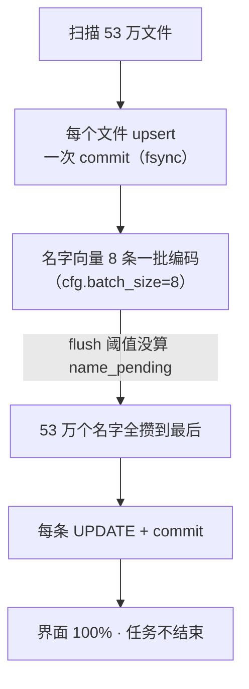

# 宇之语·灵犀 更新日志

> 版本号在 `app/version.py`，**只认这一处**：界面控制台、`/health`、打包文件名都读它。
> 规则：大功能 / 改结构 → 次版本（3.5 → 3.6）；修 bug / 小改 → 修订号（3.5.0 → 3.5.1）。

---

## v3.5.15 · 2026-11-05

**接入 MinerU v4（和 v3 并存，按需启动、用完即停），顺手修掉 v3 的两个老毛病。**

为什么要 v4：灵犀接 MinerU 本就是为了扫描件。同一批真实样本实测（同机、同卡）：

| 样本 | v3 pipeline | v4 basic | v4 standard |
|---|---|---|---|
| 古籍扫描页（竖排繁体，无文字层） | 32 字，整页就一行乱码 | 0 字 | **495 字**，整页基本读通 |
| 表格 PDF 前 3 页 | 8217 字（HTML 表格） | **2864 字（Markdown 表格，汉字 372 vs 老版 373）** | 1947 字（表格变图片） |
| 手册正文 3 页 | 590 字，目录点线糊成一团 | 715 字，目录成列表 | 同左 |
| 单页耗时 | 98~111 秒（每次现起服务） | 9~27 秒 | 30~62 秒 |

结论：**表格用 basic、竖排扫描件用 standard**，两个都要，所以档位做成 `auto`：
先 basic 保表格，识别出的字太少（< 20）自动再用 standard 跑一遍。

| 改动 | 位置 |
|---|---|
| 新增 `mineru4` 引擎（走 `/v1/tasks` 异步接口 + 结果 zip 里的 markdown） | `run/ocr_bridges/mineru4_bridge.py`（新） |
| 按需起 `:8100` 解析 + `:8101` VLM；跑完自动停（省约 4 GB 显存） | `app/ocr.py`（`start_mineru4` / `stop_mineru4` / `ensure_engine_ready`） |
| 档位 `auto`（basic → standard 兜底）、OCR 模式、用完即停，都可在界面/config.ini 改 | `app/ocr.py`、`app/filesearch.py`、`config.example.ini` |
| 修 v3 启动：原来 `run-api.cmd` 写死 `--host 0.0.0.0 --port 8000`（撞 OXR、暴露到局域网）→ 只绑 127.0.0.1、端口按配置 | `app/ocr.py::start_mineru_api` |
| 修 v3 停止：`mineru_api_pid()` 端口写死 8000，8100 上永远停不掉 → 按配置取端口 | `app/ocr.py::mineru_api_pid` |
| 修 v4 启动：直接起 `mineru-api.exe` 会去写 `C:\Users\<你>\.mineru`（WinError 5）→ 带便携环境 | `app/ocr.py::_portable_env` |

> [!warning] 三个踩坑（都写进了代码注释）
> 1. `cmd /c "call portable-env-4.cmd && mineru-api.exe …"` 用 subprocess 传列表时，
>    整串会被再包一层引号 → cmd 报“不是内部或外部命令”，进程根本没起来、日志是空的 ✗
>    （改成把便携环境变量算好直接传给子进程 ✓）
> 2. v4 的 CLI `-o` 要的是**文件**不是目录（代码里直接 `open(dir)` → Permission denied）
> 3. v4 的 doclib 崩溃后会留 `.mineru-service.lock`，再起会报
>    “Upload directory is already owned by another API service” → 删锁重启 ✓

---

## v3.5.14 · 2026-11-04

**搜索全面进 1 秒：文件名改走 FTS5 倒排，并砍掉三处隐藏开销。**

修前（热态）：报纸 1.4~1.8 秒、合同 1.3~1.5 秒、compiler_bisector 4~8 秒、jpg 3~10 秒。
修后：报纸 0.6~0.9 秒、合同 0.6~0.9 秒、compiler_bisector 0.9~1.2 秒、jpg 0.9~1.2 秒。

四处改动：

| 改动 | 位置 | 实测效果 |
|---|---|---|
| 新增文件名/目录 FTS5 通道（中文逐字、英文整词，短语查询） | `app/namefts.py`（新） | 文件名那一路 1.5 秒 → **5~20 ms** |
| 语义检索里「每条命中单独查一次片段正文」→ 批量一次取 | `app/store.py` | 1613 次查询 → 3 次，**-0.6 秒** |
| 语义检索「1800 个候选整行取回」→ 先按分数裁到前 60~360 条 | `app/store.py` | 整行取回 0.25~0.5 秒 → **0.03 秒** |
| 正文 FTS「三表 JOIN + bm25」→ 先 FTS 取 id 再取元数据；纯英文词不再拆碎片重试 | `app/ftsindex.py` | jpg 13.5 秒 → **0.23 秒**；compiler_bisector 白花的 1 秒没了 |

「矩阵是否过期」的 3 个 COUNT（0.13~0.49 秒/次）改成最多 3 秒查一次，自己写库立刻失效。

代价：索引库增大 **110 MB**（62 万条文件名 + 目录），建索引 62 万条约 **3 分钟**。
同步方式：写库时显式维护（`upsert_file` / `delete_paths` / `remove_folder` / `reset`），
行数或切词版本对不上就自动全量重建（后台线程，不挡启动、不挡搜索）。

> 为什么不用 trigram：FTS5 的 trigram 要求 3 个字以上，「报纸」「合同」这种两字词查不到。
> 为什么不排 bm25：全命中时 bm25 要 1.6 秒，比它替代的 LIKE 还慢；改成「新文件优先取候选 + 本地重排」。

---

## v3.5.7 · 2026-11-03

**修「仅文件名」模式扫大文件夹时假死 + 索引提速约 8 倍。**

现象：加了 `\\192.168.1.20\软件\`（53.6 万文件，仅文件名模式）后，界面显示
`done = total`、进度 100%，任务却一直"运行中"，挂了 5 个多小时不出结果。

查下来的链路（每一环都在拖慢）：

四处改动：

| 改动 | 位置 |
|---|---|
| `flush()` 阈值算上 `name_pending`，名字每 256 条一批 | `app/indexer.py` |
| 名字向量编码 `batch_size=64`（名字很短，8 条一送全是开销） | `app/indexer.py` |
| `store.set_name_vecs()` 批量 `executemany` + 索引主循环事务批处理（每 500 文件提交） | `app/store.py` `app/indexer.py` |
| 修批量标志 `_batching` 未初始化（每文件抛 `AttributeError`，还拖慢十倍） | `app/store.py` |
| 跳过判定补 `name_vec` 非空（中断后再扫能补上） | `app/indexer.py` |

实测同一文件夹（53.6 万文件，仅文件名）：

| 阶段 | 修前 | 修后 |
|---|---|---|
| 处理速度 | 15~35 个/秒（且永远不结束） | **150~225 个/秒** |
| 名字向量补齐 | 卡在最后一步 5 小时+ | 随扫描同步完成 |

---

## v3.5.6 · 2026-11-02

**MinerU 与 OXR 的端口冲突。**

两家默认都用 `127.0.0.1:8000`。以前灵犀只判断「8000 有 HTTP 就算 MinerU 活着」，
所以 OXR 占着 8000 时，MinerU 明明没起也会显示「运行中」。

- 新增 `[ocr] mineru_api`，可指到别的端口（本机 MinerU 已挪到 **8100**）
- `mineru_api_alive()` 改成检查 `/openapi.json` 里有没有 `/file_parse`，认准是 MinerU ✓
- 设置页提示行同时显示 MinerU / OXR 的地址，端口撞车一眼能看出

> 两个都用着的话：MinerU 换端口启动（`_api8100.cmd`，就是 `run-api.cmd` 改了个 `--port 8100`），
> 灵犀里把 `mineru_api` 填 `http://127.0.0.1:8100`。

---

## v3.5.5 · 2026-11-02

**接进第 4 个 OCR 引擎 OXR（版面理解 + 表格还原）。**

本机另装了 [OXR](https://github.com/SoMarkAI/OXR)（`D:\GJ\AIOXR`，三个服务：解析 8000 / 模型 8080 / 布局 8081），
灵犀通过 HTTP 桥接使用它：

- 「设置 → OCR」引擎下拉多一项 **oxr**；旁边显示「OXR API：运行中 / 未运行」
- 同一页可改 **OXR 解析服务地址**（默认 `http://127.0.0.1:8000`）和桥脚本路径
- 表格会被还原成 **HTML 表格**（`<table>`），标题识别成 Markdown `#`，比纯文字行更像原文
- 推理跑在 AIOXR 那三个服务里，**不占灵犀自己的显存**，两边可以同时开

实测同一页（A4、200dpi）：

| 引擎 | 耗时 | 字数 | 表格 | 特点 |
|---|---|---|---|---|
| oxr | 32.7 s | 592 | **HTML 表格保留** | 标题/正文/表格分块，段落不断行 |
| ppocr | 34.3 s | 492 | 拍平成单行文字 | 只给文字行，不带结构 |

**顺手修的两个坑（都影响所有引擎）：**

- 系统 `NO_PROXY` 里带 `[::1]` 时，桥脚本一启动就报 `InvalidURL: Invalid port: ':1]'`
  （httpx 把方括号写法当 URL）→ 灵犀调用桥时自动把 `[::1]` 规范成 `::1`
- 桥脚本输出统一强制 UTF-8：GBK 控制台下，报错信息里带 emoji 会让 `print` 二次崩溃，
  真正的错误反而看不见

---

## v3.5.4 · 2026-11-02

**启动不再有黑框，也不会被误关。**

之前：每次启动都弹一个「宇之语·灵犀 服务窗口」命令行黑框，最小化后仍挂在任务栏，
一不小心关掉，服务就断了。

现在：

- 服务改成**隐藏启动**（`app\run_server_hidden.vbs`）：没有任何命令行窗口，误关不到
- 新增 **`启动灵犀.vbs`**：双击即启动，全程无窗口；只有启动失败时才弹提示框并指向日志
- 启动前给一个 3 秒自动消失的「正在启动…」提示，不会误以为没反应
- 要停服务仍用 `stop.bat`；想看启动过程仍可直接双击 `start.bat`（与以前一致）
- 界面里的「重启服务」和 `run\restart_server.py` 也走隐藏启动，不再留黑框

> 隐藏模式下出错不 `pause` 等人（窗口看不见会一直挂着），改成等 8 秒退出；
> 错误仍完整写进 `logs\server.log`。

---

## v3.5.3 · 2026-10-27

**文件夹出错时能自己救回来。**

- 文件夹页新增 **「🔄 重新检查目录」**：不用等 30 秒轮询，立刻重查每个目录在不在、
  网络盘挂载点还在不在（并行探测，19 个目录 0.4 秒出结果）
- 服务器版管理员多一个 **「♻ 重启服务」**：NAS 重启后句柄失效，一键重启进程最干脆
- 原因提示更具体：`本机 Windows 路径（服务器上本来就没有）` / `网络盘挂载点不在了` /
  `检查超时，NAS 可能没响应` / `目录不存在` —— 不再一律报「目录不存在」误导人
- 目录存在性加 60 秒缓存 + 后台刷新（先显示旧值、后台再查），网络盘不再拖死页面；开机预热缓存

---

## v3.5.2 · 2026-10-23

**聊天页改成内滚动。**

之前：气泡区高度不封顶，聊得越久页面越长，输入框被顶到很下面，得先滚页面才看得见。

现在：

- 聊天这一页**按视口定高**，只有消息区在内部滚，输入框和下面那排开关永远贴在底部
- 页面本身不出现滚动条（实测 1440×900 和 1280×720 都正好贴合）
- 窗口缩放、切换标签时会重新量一次高度（页头高度变了也不跑偏）

---

## v3.5.1 · 2026-10-23

**修一个小 bug 就出一个小版本，方便你判断对面装的是不是最新的。**

### 修了什么

| 问题 | 根因 | 现状 |
|---|---|---|
| 聊天页勾了「知识库」，回答下面**没有任何标记**，不知道到底查了没有 | 聊天页走的是**流式**接口，而流式那条分支**根本没做知识库检索**（非流式的 `/send` 才有）——`use_kb` 读了却没用，等于勾了个寂寞；而且代码读的是 `res.get("hits")`，检索器返回的键是 `results`，等于永远空结果 | 已补上检索；回答下面显示 `📚 参考了自己的资料：[K1] 某某.pdf · [K2] …`；一条没查到会明确写「知识库里没检索到相关内容」 |
| 知识库问答选「云端 opencode」报 `外部模型调用失败：'str' object has no attribute 'items'` | 昨天那次改动里，`headers` 从偏好里取出来是 **JSON 字符串**，直接传给了 `vlm_client._headers()`，那里对它调 `.items()` | 已修：`apimodels.headers_of()` 统一解析（字符串 / 字典都行），`_headers()` 自己也兜底 |

### 新增：界面右上角的版本号

- 页头右侧显示 `v3.5.1`，鼠标悬停能看到版本 + build 时间，点一下复制版本信息
- **服务已升级、页面还是旧缓存**时，徽标会变黄：`v3.5.1 → v3.6.0 刷新`，点一下直接强刷
  （以后就不用靠"记不记得按 Ctrl+F5"来判断是不是新版了）

### 顺手做的

- 版本号集中到 `app/version.py`，`/health` 返回 `version` / `build`
- 前端控制台显示 `灵犀 v3.5.1 build …`
- 打包脚本、升级说明都从同一个版本号生成，不再各处硬写

### 升级提示

**没有数据库结构变化**，覆盖 `app/` 即可。升级后 `curl -s localhost:8199/health` 应能看到 `"version":"3.5.1"`。

---

## v3.5.0 · 2026-10-22

### 界面

- 顶部重整为 5 个主标签：💬 聊天 / 🔍 搜索 / 📚 知识库 / 📁 文件夹 / ⚙ 设置
- 「人物」并进「设置 → 人物命名」；「默认排除目录」挪到「文件夹」页
- 设置页分 4 类：服务器与共享 / 模型与系统设置 / 人物命名 / 备份与恢复（二级标签顺序固定）
- 首屏「运行中」**14.3 秒 → 3.0 秒**：轮询改成只在当前标签页跑

### 聊天 / 知识库

- 知识库问答页新增「☁ Dify 一起查」；回答里本库标 `[1]`、Dify 标 `[D1]`
- Dify 知识库改为**个人私有 + 可共享**：每个库可选「只有我 / 所有登录用户 / 指定的人」
  - 共享出去的是"能用它检索"，**密钥永不下发**
  - 别人共享给你的库，会列在自己卡片下方

### 模型

- 普通用户能用服务器上的**公用模型**（无密钥的 llama.cpp），不用自己配
- 管理员那套带密钥的，只要没共享，普通用户看不到、也用不了
- 「共享模型」改成卡片内一行「谁能用」，可点名共享（原来那个弹窗点了没反应）

### 服务器同步

- 「服务器连接」改为**必填账号密码 + 「保存并验证」**：会真的登录一次服务器，并显示两边身份
- 「上传到服务器」不再能填账号：身份只认验证过的那一组，防止临时换身份乱传

### 修的老 bug

- 同步客户端登录字段名写错（发 `password`，接口收 `pwd`）→「账号+密码」这条路以前**从没成功过**
- 浏览器还引用着旧哈希脚本时，服务器回空 404 → 页面报 `Unexpected end of input`；现在返回"自动刷新一次"的脚本
- 心跳中间件把哈希文件的 `immutable` 缓存头盖成 `no-cache` → 每次开页面重下 325 KB
- 预览 Markdown 时图片 `onerror` 引号截断 → 满屏 404 + 语法错误

---

## v3.0 · 2026-10-22

多人版：归属隔离 / 共享 / ACL、账号体系、聊天（会话/联网/知识库/Dify/附件）、外网部署、
API 共享指定人、用户自助改名改密、静态资源拆包 + gzip。

## v2.x

本地语义搜索：embeddinggemma-2 多模态索引、按文件夹模式、图片打标、OCR（可选）、
预览与定位、备份恢复。
